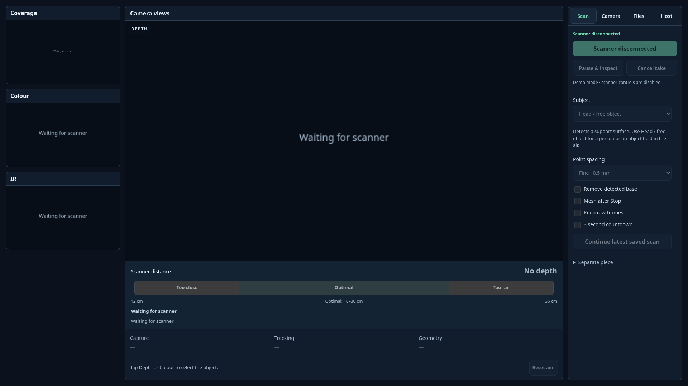

# triBUUTSCAN — Rob's fork

Browser-controlled Linux scanning for the **Creality CR-Scan Ferret Pro**. Connect
the scanner to the host PC over USB, and control capture from that PC or a phone,
tablet or laptop on the same trusted network. Tracking, fusion and meshing run on
the host; the remote device receives previews and sends controls.

This is [barnard704344/tribuutscan](https://github.com/barnard704344/tribuutscan),
based on [gegirti/tribuutscan](https://github.com/gegirti/tribuutscan). This guide
describes this fork's browser build. Historical desktop screenshots, old speed
claims and upstream development notes are not instructions for the current UI.

## Start here

| Task | Documentation |
| --- | --- |
| Install, connect a phone and capture a scan | [User guide](docs/user-guide.md) |
| Tour the browser workspace, tabs and phone pairing | [Web UI tour](docs/web-ui.md) |
| Inspect, clean up, mesh and export saved scans | [Saved workspace](docs/saved-workspace.md) |
| Manually align two saved free-object scans | [Saved-scan alignment](docs/alignment.md) |
| Fix connection, depth, tracking or startup problems | [Troubleshooting](docs/troubleshooting.md) |
| Understand the scanner, calibration, GPU pipeline and output files | [Technical reference](docs/technical-reference.md) |
| Develop, test and measure changes | [Development guide](docs/development.md) |
| Check completed work and unfinished work | [Build status](docs/build-status.md) |
| See proposed inspection and cleanup additions | [Saved-workspace roadmap](docs/roadmap.md) |

## Install and launch

The supported host workflow is Linux with USB 3, access to the scanner's video
nodes, and Python. Python 3.10+ is declared by the package; the GPU extra needs
Python 3.11+. Use the same system interpreter when creating the worker environment.

```sh
git clone https://github.com/barnard704344/tribuutscan.git
cd tribuutscan
uv sync --all-extras
./tribuutscan-viewer.sh
```

The shell launcher uses system `python3`, which must have NumPy installed. If that
interpreter does not have NumPy, run the web host directly with the environment:

```sh
.venv/bin/python -m tribuutscan.webapp
```

For 14-bit USB depth, install the supplied device rule, reload it and reconnect the
scanner. The application can otherwise fall back to 10-bit V4L2 depth. Run this
from the repository directory, not your home directory. The `cd` below assumes
you cloned into `~/tribuutscan`; replace it with your existing checkout's path
if you installed elsewhere.

```sh
cd ~/tribuutscan
sudo cp udev/70-tribuutscan.rules /etc/udev/rules.d/
sudo udevadm control --reload-rules
sudo udevadm trigger --subsystem-match=usb --attr-match=idVendor=2bc5
```

If `cp` reports `cannot stat`, the rule was not installed. Check that
`ls udev/70-tribuutscan.rules` finds the file before retrying. Reloading and
triggering rules does not fix a failed copy.

For a host without a desktop browser:

```sh
./tribuutscan-viewer.sh --no-browser
```

The service prints its local URL and pairing links. In the workspace, open
the **Host** tab on the right and choose **Connect a phone** to pair another
browser by scanning its QR code or opening the pairing link. QR codes are generated
locally. The default listener is `0.0.0.0:8765`. Pairing protects controls, previews
and downloads, but HTTP does not encrypt the connection. Use a trusted LAN; do not
forward this port directly onto the internet.

## This fork's workflow



*1920×1080 browser screenshot in demo mode. No scanner is connected; see the
[illustrated web UI tour](docs/web-ui.md) for the tools and phone layout.*

- Coverage, Colour and IR previews sit on the left; Depth and its distance gauge
  occupy the centre. The desktop workspace fits a 1920×1080 display and adapts to
  smaller screens. The right column groups tools into **Scan**, **Camera**,
  **Files** and **Host** tabs; start/stop and pause stay available across tabs.
- Use **Head / free object** for a head or a held subject. Use **Object on a table**
  when support-plane detection is appropriate. The selected subject is remembered.
- **Pause & inspect** moves coverage to the centre. Drag to turn the coverage
  camera; scroll, pinch or use the buttons to zoom. The host renders the existing
  coverage classifications. There is no extra live point-cloud window.
- **Resume** restores the normal layout and capture. **Stop & Save** saves the
  take and starts optimisation; meshing follows if enabled.
- Saved scans open in a matching **View / Align / Cleanup / Mesh / Export**
  workspace, with automatic editing copies, lasso deletion and persistent undo/redo.
  Files remain in this checkout's ignored `captures/` directory.
- **Files → Open scan → Align** loads the opened scan as the blue reference.
  Choose a second scan, then drag the amber scan with **Move scan / Rotate scan**,
  or fit matching points. **Refine alignment** proposes a small surface fit, with
  optional overlap selection and one-step undo. Saving creates a new full session. See
  the [first-release limits](docs/alignment.md#first-release-limits) before using it.

## Status and limits

GPU depth preparation, TSDF fusion, tracking against the fused model and meshing
are implemented through WebGPU. CPU processing paths are retained. This is a
vendor-neutral implementation, not a guarantee that every GPU or driver works.
The browser host and USB capture workflow are Linux-specific.

**Sustained 30 processed frames per second is still a target.** A local observation
was about 22 processed fps while the cameras supplied 30 fps; it was not a controlled
cross-hardware benchmark. The performance meter and recovery indicator are
checkpointed work that still need validation. See [build status](docs/build-status.md)
before treating displayed counters or historical benchmarks as acceptance results.

Coverage colours describe observed surfaces. They cannot measure unseen surfaces,
prove completeness or guarantee dimensional accuracy. A scan that loses tracking
can keep receiving camera frames without adding geometry.

## Origin and licence

This fork retains the upstream scanner protocol work, calibration support,
tracking/recovery, point-cloud merging, optimisation, fusion and export pipeline.
The original project was created by 3BUUT; see the upstream repository for its
history. Historical measurements apply to the hardware and revisions that produced
them, not automatically to this build.

The project is MIT licensed. The original copyright and permission notice remain
in [LICENSE](LICENSE). The vendored Three.js assets retain their own
[licence notice](tribuutscan/web/THREE-LICENSE). The bundled
[Nayuki QR generator](tribuutscan/web/qrcodegen.js) retains its MIT notice in the
source header ([upstream](https://www.nayuki.io/page/qr-code-generator-library)).
This independent project is not
endorsed by Creality or Orbbec.
