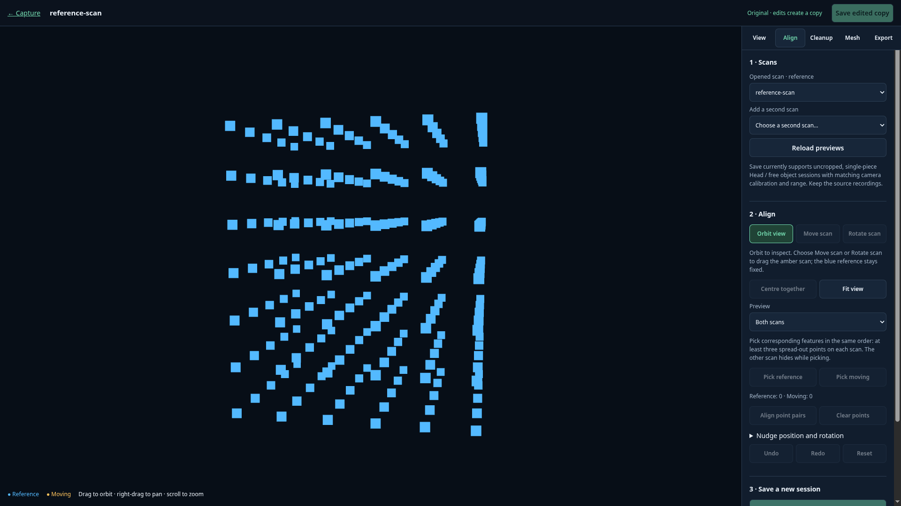
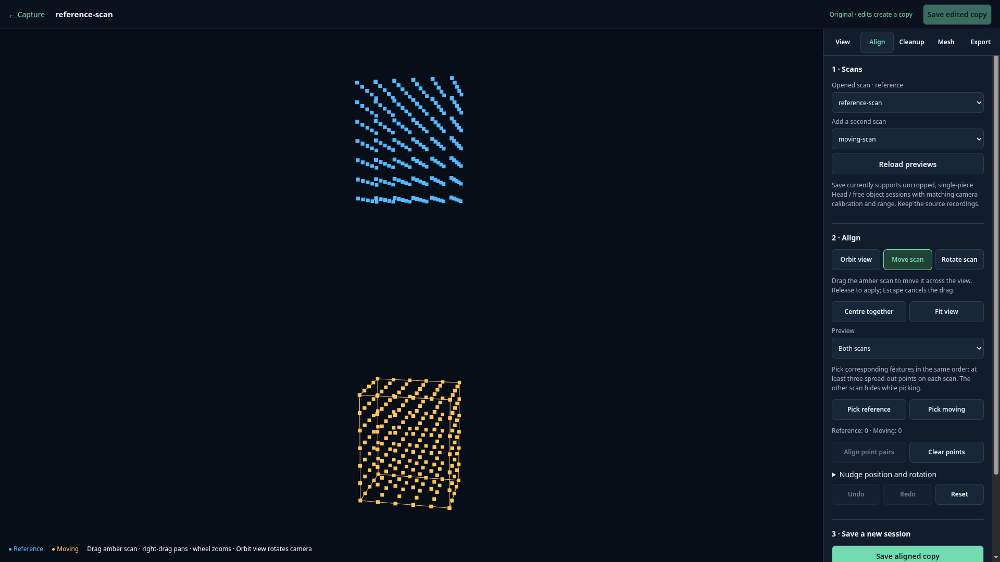

# Aligning saved scans

Open a saved scan from **Files → Open scan**, then select the **Align** tab.
This is a saved-scan tool; it does not replace the live coverage pane or its paused camera.
You can use it without the scanner connected, with the scanning environment installed.

*Browser screenshot using synthetic point-grid sessions, not a physical scan.*

## First-release limits

Saving currently requires two **uncropped, single-piece Head / free object**
sessions with the same saved camera calibration fingerprint and depth range.
Keep `session.json`, keyframes, merged-frame data and scene data with each scan.
Keep the referenced raw recordings for later meshing. A bare PLY is not a full
processable session. Cropped scans, lasso-cleaned sessions, tabletop sessions and multi-piece sessions
are rejected for now, rather than merging their incompatible masks or scene regions.

## Align and inspect

1. The opened scan loads automatically as the blue **Reference**. Choose a
   second scan under **Add a second scan**; its amber preview loads automatically.
   **Reload previews** is available if a source changes or a load needs retrying. Preview downloads are limited to 200,000
   points per scan; saving uses the full saved frame data.
2. Choose **Move scan** and drag the amber scan to reposition it across the
   current view. Choose **Rotate scan** and drag it to turn it around its centre.
   An amber outline identifies the moving scan. The blue reference stays fixed.
   Release to apply one undoable adjustment; **Escape** cancels the current drag.
   Mouse and one-finger touch dragging are supported.
3. **Orbit view** rotates the camera; right-drag pans and the wheel zooms. To move
   the scan along a different plane, orbit to another angle, then use Move scan.
   **Fit view** frames both scans. The **Preview** selector shows either scan alone.
4. For optional feature-based fitting, use **Pick reference** to select at least three distinctive, spread-out
   features. Select the same features in the same order with **Pick moving**.
   Only the selected scan is visible while picking. Click a pick button again
   to finish picking. Orbiting remains available; a drag does not select a point.
5. Press **Align point pairs** when using landmarks. Three to twelve pairs are supported. Collinear
   or coincident selections are rejected. The reported RMS error measures only
   the selected point pairs; it does not establish whole-surface accuracy.
6. Inspect the overlap from several angles. Use **Nudge position and rotation**
   for adjustments in millimetres and degrees. Rotation is around the moving
   scan's centre. Leaving a numeric field commits that adjustment and resets the
   field to zero for the next nudge. **Undo**, **Redo** and **Reset** affect the
   preview transform, not the saved originals. **Centre together** is a starting
   aid, not automatic surface registration.

Clear and repick landmarks if a point was selected incorrectly. Changing either
source selection reloads the relevant preview automatically and clears the old
alignment and landmark selections.

*Synthetic browser test: the outlined amber scan is adjustable; the blue reference is fixed.*

## Save and clean up

Press **Save aligned copy** after inspecting the alignment. Saving requires
capture, recording and other processing to be idle. A separate host job creates
a new `*-aligned-*-scan` directory. Both original sessions remain unchanged.
The saved result retains transformed frame poses, masks, keyframes and references
to source recordings, rather than exporting only the displayed point cloud.
An `alignment.json` file records the source names, transform and source versions.

Saving does not run pose optimisation: that could alter the alignment you just
approved. It also does not claim that the scans overlap sufficiently. If a source
changed since loading, reload it before saving. A failed job does not publish a
partially written result.

Choose **Inspect result, crop & process** when saving finishes. The saved-result
workspace provides cleanup, mesh generation and exports. Choose **Mesh → Generate mesh**
when ready; source recordings and compatible calibration must still be available.

After alignment, use the [Cleanup tab](saved-workspace.md#cleanup) for lasso deletion
and crop/base cleanup on an editable copy. Align and optimise before applying
world-space lasso cleanup. Automatic surface refinement, brush tools and automatic
island/mesh repair are not implemented yet.

The initial implementation was checked with synthetic sessions and browser
interactions. Real head scans still need a physical validation run.
