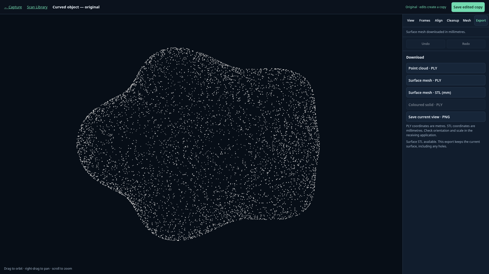

# Surface STL export

Open a saved scan and generate a surface in **Mesh**, then use **Export**.

- **Printable mesh · STL (mm)** downloads an existing saved STL.
- If no saved STL exists, **Surface mesh · STL (mm)** converts the current
  surface from metres to millimetres and downloads `<scan-id>-surface-mm.stl`.
- Without a surface mesh, the STL download is disabled.

Load the file into your chosen CAD application or slicer and select millimetres
if asked. The app has no external modelling links or automatic CAD-project import.

Surface conversion preserves triangle geometry and orientation, including holes
and rough fallback surfaces. It does not close the mesh or certify dimensions.
Binary STL does not carry vertex colour. An existing printable STL may include
reconstructed regions; check critical features against the source scan.

Cleanup and frame rebuilds can retire generated meshes. Regenerate them before
exporting. The surface export checks the selected scan and mesh versions and
rejects stale downloads; it never modifies the capture or its mesh files.
