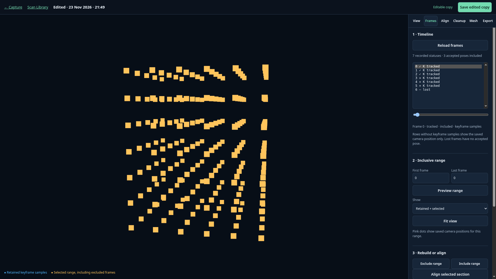
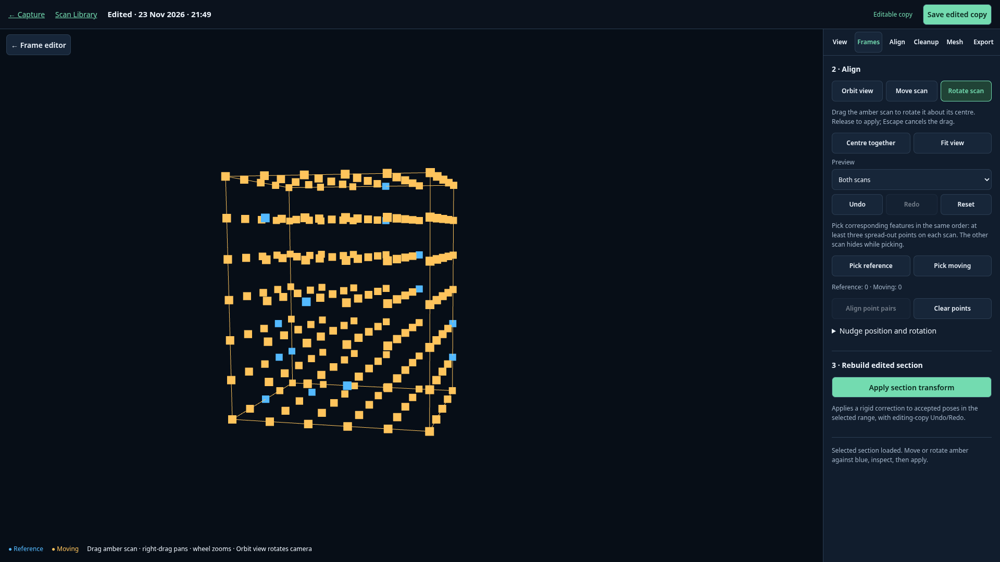

# Accepted frame editor

Open a saved scan and choose **Frames**. The editor works on saved accepted poses
and keyframe point samples, with processing on the host. Capture and recording
must be idle to save changes. Rebuilds currently require an uncropped **Head /
free object** session before lasso cleanup.

## Inspect the timeline

The list includes saved tracking statuses and distinguishes included (`✓`),
excluded (`×`) and unposed (`–`) frames. `K` marks a merged keyframe with cached
point samples. Select a row or scrub the slider to inspect its frame index,
original tracking status, overlap/residual metrics when recorded, and position.
These metrics describe the original tracking solve, not the quality of a later
manual correction.

Blue samples show the retained reference outside the range. Amber samples show
the selected range, including frames currently excluded. Pink dots show its saved
camera positions. **Show** switches between retained, selected or both previews.
Previews are sampled to at most 100,000 points per group. Changing visibility
alone never edits saved data.

The timeline is not a raw colour/depth-image player. A non-keyframe can have a
saved pose without cached point samples; it then shows its camera position only.
A lost frame with no pose cannot be turned into accepted geometry by including
it. Re-tracking unposed raw frames is separate future work.

## Exclude or include a range

Enter inclusive **First frame** and **Last frame** indices, then **Preview range**.
Use **Exclude range** to remove those accepted contributions and rebuild, or
**Include range** to restore previously excluded accepted frames from the preserved
baseline. You must retain merged keyframes that produce a usable output.

The first saved operation creates an editing copy. Source captures remain
unchanged. Rebuilding filters cached merged contributions and the full accepted
pose list used by future meshing; excluded raw views therefore cannot sneak back
into the mesh. Recordings are not deleted. Untracked frames stay unposed.

Old surface/solid/STL exports are retired. Use **Mesh → Generate mesh** after
finishing frame edits. It uses the retained corrected poses when matching raw
recordings and calibration are available; otherwise existing rough-mesh fallback
limits still apply.

## Manually align a section

Choose a range containing cached keyframe samples, leaving some retained reference
samples outside it. Press **Align selected section**.

The existing alignment controls work on these two groups: blue stays fixed and
amber is the selected section. **Move scan / Rotate scan** lets you drag amber;
use orbit to inspect, numeric nudges or corresponding point pairs as needed.
Preview Undo/Redo and Reset affect only the proposed transform. Automatic surface
refinement between frame groups is not included in this first release.

**Apply section transform** applies the same rigid world correction to every
accepted pose in the inclusive range and rebuilds. Unselected poses stay fixed.
It does not interpolate a correction across the range boundary, invent a missing
pose, or judge the alignment for you. Inspect overlap from several angles before
applying. Correct further sections separately when needed; unrelated/unjoined
sections are not automatically aligned by correcting one range.

## Undo, reset and preserved data

**Undo / Redo** use the saved workspace's persistent editing history. **Reset all
frame edits** restores the baseline accepted selection and poses, rebuilds and is
itself undoable. It does not restore retired meshes automatically.

The first frame edit preserves the baseline pose, keyframe, merged-sample, mask,
scene and session files in `frame-source.zip`. Current operations are recorded in
`frame-edits.json`. These stay with editing copies and their history and add storage alongside the
active cache; the Library includes them in folder sizes. The archive
contains cached contributions, not complete raw recordings; keep the original
capture layout and referenced recordings in backups.

Geometry reprocessing that changes spacing or optimises poses is blocked while
frame edits are active; reset those edits first. Frame editing is also blocked
after crop/lasso cleanup. Align separate saved scans before frame editing, then
perform geometric cleanup and meshing. A content/selection change in another
browser invalidates old editor commands and previews.

Synthetic tests cover exclusions reaching future fusion, restoring frames,
translation/rotation conventions, original preservation, nested recording links,
Undo/Redo, stale/busy/pairing guards and the browser handoff between the editor
and section alignment. Real interrupted scans and very large sessions still need
validation. This editor repairs accepted saved data; it does not rewind a running
GPU volume or replace live tracking recovery.
