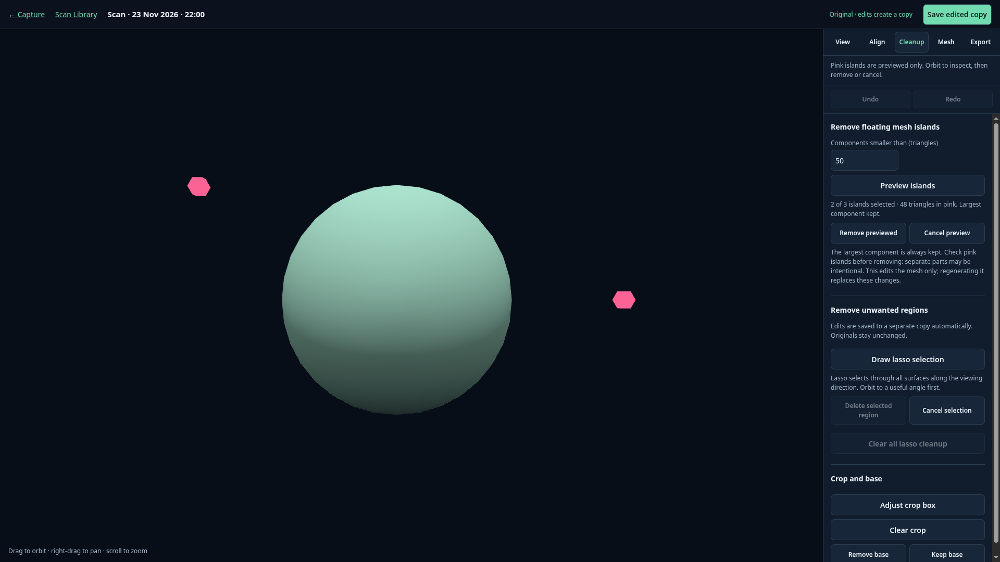

# Floating mesh islands

Open a saved scan and generate its surface in **Mesh**. In **Cleanup → Remove
floating mesh islands**, enter a minimum component size in triangles, then press
**Preview islands**. The default is 1,000 triangles.

Components smaller than the threshold are marked pink; the largest component is
always retained, even below that threshold. Components are connected through
shared triangle edges. Surfaces that merely lie close together are not joined by
this operation. The reported counts describe topology, not a judgement of which
part is the intended subject.

## Preview, inspect and apply

Orbit the mesh and inspect the pink regions. Detached components can be intentional
parts, thin features or incomplete surfaces. Increase/decrease the threshold and
preview again to change the selection. A new threshold cancels the old preview.

**Cancel preview** restores the original local display without saving anything.
Leaving Cleanup, changing the scan/mesh, drawing a lasso or starting another edit
also clears the preview. A preview with no selected triangles cannot be applied.

**Remove previewed** saves the removal. An original scan first gets an automatic
editing copy; subsequent mesh edits use that copy's existing history. **Undo**
restores the previous surface and exports, and **Redo** reapplies the edit. The
usual editing-history limit applies. Source scans remain unchanged.

## What changes

Only the saved surface mesh is filtered. Vertex colour and other saved vertex
attributes are preserved; unused vertices are removed and face indices remapped.
The point cloud, fused point sums, source recordings, poses and lasso/crop rules
remain unchanged. Session metadata records the mesh cleanup summary.

Previous printable STL and coloured-solid exports are retired because they can
still contain the removed islands. **Export → Surface mesh · STL (mm)** downloads
the cleaned surface directly. This does not close holes or create a printable
solid. Regenerating a mesh from the source points/recordings replaces the manual
mesh cleanup and may bring islands back. Undo is the way to recover the previous
mesh and its exports.

## Processing and safeguards

Analysis runs in a separate host process, with a preview mask fetched once rather
than included in regular status polling. Applying rechecks the mesh content hash
and rejects a changed surface. Capture/recording/processing must be idle, and the
normal paired-browser and stale-selection guards apply. Standalone inspection
without the host's editing service does not offer these operations.

Automated and synthetic browser checks cover disconnected components, largest-part
protection, preview cancellation, automatic copying, colour/source preservation,
stale/busy guards and persistent Undo/Redo. They do not establish the right
threshold for every real scan or a performance guarantee on very large meshes.
