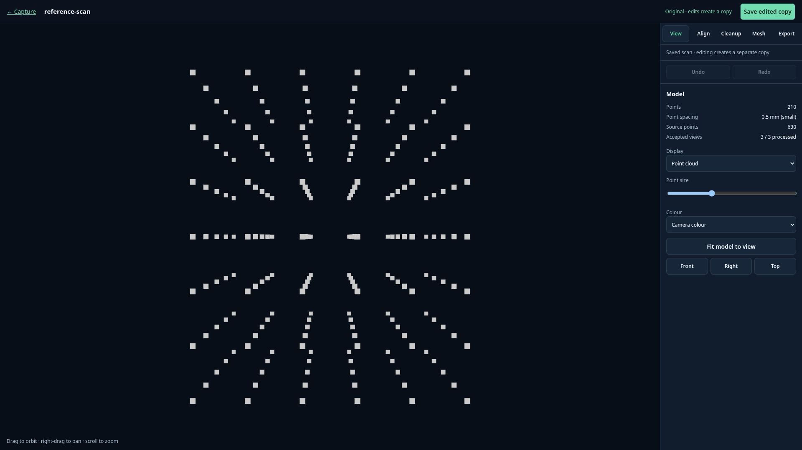
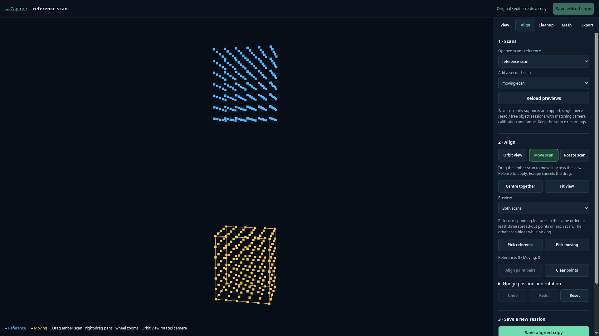
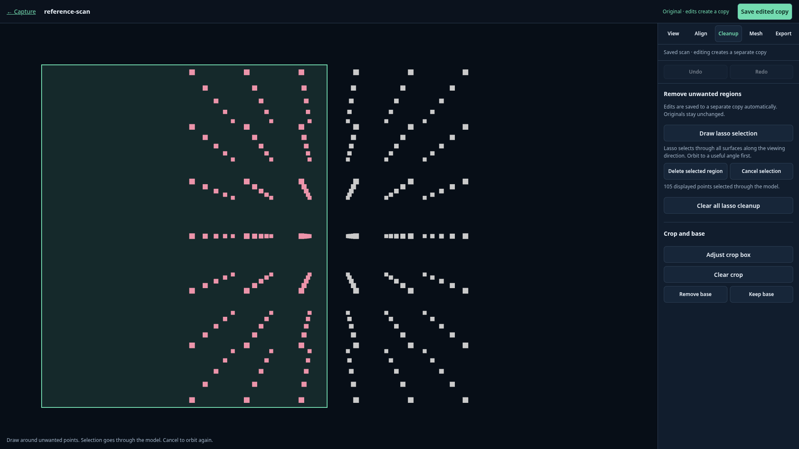

# Saved-scan workspace

Choose **Files → Saved scans → Open scan** in capture. The selected result opens
in a workspace with the same colours and tabbed controls as the capture UI.
**← Capture** returns to capture; opening a saved scan does not require the scanner
to be connected. Editing and processing require capture/recording to be idle.

*All screenshots here use synthetic point-grid sessions, not private scanner data.*

## View

Inspect the point cloud, generated mesh or printable solid. Drag to orbit,
right-drag to pan and scroll to zoom. **Fit model to view**, **Front**, **Right**
and **Top** provide useful starting views. Choose camera colour, grey, height or
observation colouring. Coverage reflects observed points, not unseen surfaces.

The side panel reports point count, spacing and accepted views. Blank live
capture/tracking fields are not presented as saved-scan status. A chosen display
mode stays selected when polling reloads generated artifacts.

## Align

The **Align** tab hosts the existing two-scan alignment tools inside the workspace,
automatically loading the current result as reference. Choose a second scan to
load its preview automatically, then adjust position/rotation or optionally pick
matching landmarks. Save a new aligned session and open its result to return to
this workspace. Switching tabs preserves the loaded pair for the same opened scan.

For quick manual alignment, choose **Move scan** or **Rotate scan** and drag the
amber scan directly. The blue reference stays fixed. Use **Orbit view** to move
the camera. Each completed drag is one undo step; Escape cancels an active drag.

See [alignment](alignment.md) for restrictions. Align uncropped, single-piece
free-object scans with matching range and calibration **before** lasso cleanup.

## Editing copies and history

**Save edited copy** creates a new `*-edit-*-scan` session. The first cleanup or
mesh/processing action on an original also creates this copy automatically.
Original files remain unchanged. Copies retain frame data and references to raw
recordings; they do not duplicate the raw recordings, so keep those sources.

Changes on the copy are saved on the host. **Undo** and **Redo** restore saved
geometry, cleanup policy and available mesh files, not just the camera. History
survives browser refreshes and host restarts, retaining six states (up to five
undo steps). A new edit after Undo discards that redo branch. History takes disk
space; the application checks for room before copying session data.

Operations run on a temporary sibling session before being published. A failed
processing operation leaves the working geometry at its previous revision.
Selections that changed in another browser or source versions that changed since
loading are rejected rather than applied to a different model.

**Continue latest saved scan** in capture skips editing copies and continues a
capture session. Use an original capture for further scanning, then edit its output.

## Cleanup

1. Orbit to an angle that separates the unwanted region from the wanted surface.
2. Choose **Draw lasso selection**. The view changes to points and camera movement
   pauses while selecting.
3. Draw around the unwanted points. Selected displayed points turn pink, with a
   count in the panel.
4. Choose **Delete selected region** to save the cleanup, or **Cancel selection**
   to release the camera without deleting anything.

**Selection goes through all surfaces along the viewing direction**, not just the
frontmost surface. Check the highlighted region before deleting, and use Undo
if needed. Up to 32 lasso regions are retained per editing session. **Clear all
lasso cleanup** restores regions removed by lassos, while leaving crop settings.

Lasso regions are saved in world space and filter point-cloud output and regenerated
mesh surfaces. They do not destroy the raw depth recordings. Align and optimise
first: pose optimisation is refused while lasso regions exist, because moving the
geometry would change where those regions cut it. Clear or undo cleanup first.

**Adjust crop box** keeps the geometry inside its six adjustable faces. **Clear
crop** restores the pre-crop extent. **Remove base / Keep base** use the detected
support plane when the scan has one. These operations also use the editable copy
and persistent history. Rebuild a mesh after lasso or base cleanup.

## Mesh

**Generate mesh** fuses recorded depth when the recordings and matching calibration
are available. A rough point-cloud mesh may be generated instead if those sources
cannot be used. The status message distinguishes the fallback.

**Optimise alignment** and the point-spacing buttons reprocess the saved geometry.
Spacing is not a dimensional-accuracy guarantee. Geometry changes may retire meshes;
generate them again before exporting. If reconstructing a closed solid crosses a
deleted lasso region, the cleaned surface is exported instead, with closure marked
false. Do not assume every STL is watertight or suitable for printing.

## Export

Download the point cloud, surface mesh, available STL or coloured solid, or save
the current camera view as PNG. Unavailable artifacts are disabled. PLY coordinates
are metres; STL coordinates are millimetres. Check scale and orientation in CAD or
the slicer. Saving a PNG does not save the processing session or raw recordings.

This release adds manual lasso/crop cleanup and integrated alignment. Automatic
island removal, hole-repair brushes, measurement/section tools, CAD deviation maps
and reverse engineering remain future work; see the [proposed roadmap](roadmap.md).
Synthetic automated and browser checks
do not replace validation on real scans.
