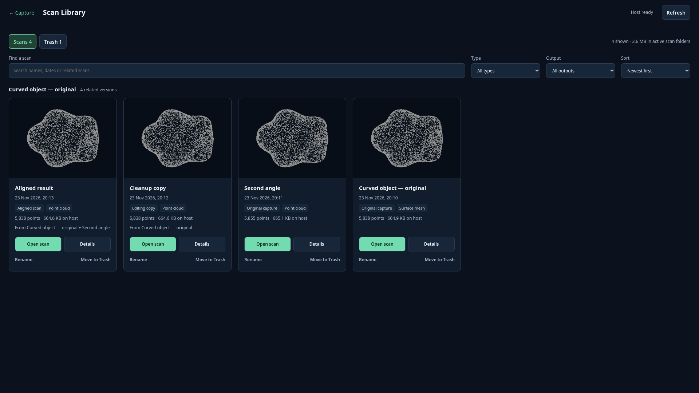
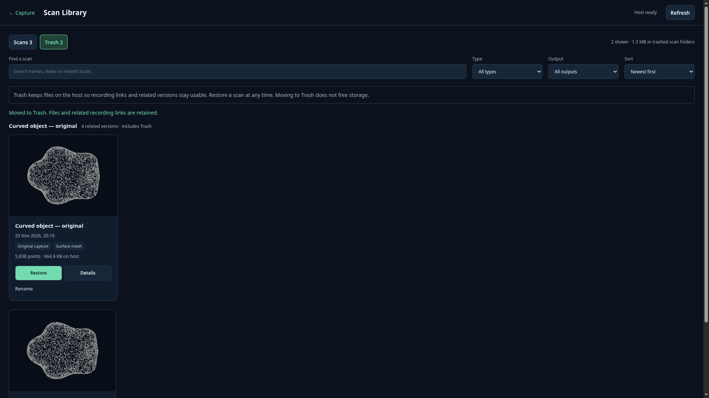
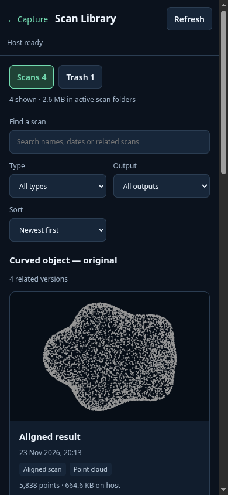

# Scan Library

Open **Files → Open Scan Library** from capture. The library is a full page at
`/library`, available to paired browsers on the host or the trusted LAN.
Thumbnails and files stay on the scanner host; no separate application is needed.

*Screenshots use generated geometry and example display names, not private captures.*

## Find and open a scan

Each card shows a thumbnail, display name, capture date, type, saved point count,
owned storage and available outputs. Search names, folder IDs, dates or names of
related versions. Filter originals, editing copies or aligned scans; show scans
with a mesh or point clouds only. Sort by date, name or size.

**Open scan** selects that session and opens the existing **View / Align / Cleanup /
Mesh / Export** workspace. Alignment automatically uses the opened scan as its
reference. Processing and download controls stay in the saved workspace, rather
than being duplicated in the library. **Scan Library** in its header returns to
the relevant card; **← Capture** returns to capture.

Browsing is available while capture/processing is active. Finish capture,
recording and processing before opening a saved scan or changing library entries.
Demo mode allows browsing but disables organisation changes.

## Names and related versions

**Rename** changes a display name, up to 100 characters. It does not rename the
folder, change geometry, alter source links or replace the scan's stable ID.
Names also appear in the saved workspace and alignment source selectors.

Original captures, editing copies and aligned results are grouped by recorded
source relationships. Aligning two captures can connect both into one family.
Use **Details → Related versions** to find a parent or derivative, including one
in Trash. Grouping describes provenance; it does not establish alignment quality.

## Storage and recording links

**Details** separates geometry/session data, mesh exports, undo history and
recordings owned by the scan folder. Referenced recordings may be shared and are
not counted again in that folder's total. Missing recording references are marked;
viewing the saved point cloud can still work when recording-dependent meshing does
not. Recordings outside the captures folder are identified as external.

Folder sizes are logical file totals, not a filesystem free-space measurement.
History and related copies use storage too. A thumbnail is a sampled illustration
of the point cloud, not evidence of scan completeness or export quality.

## Trash and restore

**Move to Trash** asks for confirmation. The scan leaves normal library results,
alignment selectors and automatic capture continuation. If it was the selected
saved model, that host selection is cleared. Related versions remain available.

Trash is reversible: files remain in their original folders so recording links
and other versions' dependencies keep working. **Trash → Restore** returns the
same scan ID and display name. Moving to Trash does **not** free storage. This
version has no permanent delete or Empty Trash action.

Library names, revisions and trash markers are stored in the ignored
`captures/.scan-library.json`. Thumbnails are cached under
`captures/.library-thumbnails/`. Preserve the metadata with a backup to retain
organisation; preserve the complete capture layout to retain source recordings
and edit history. Portable project packaging remains future work.

## Phone layout

Cards stack on narrow screens, with the same search, filters, details and restore
controls. Processing remains on the host.

