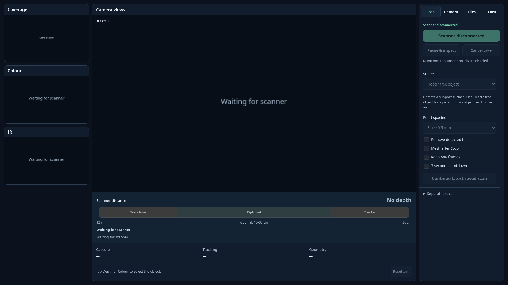
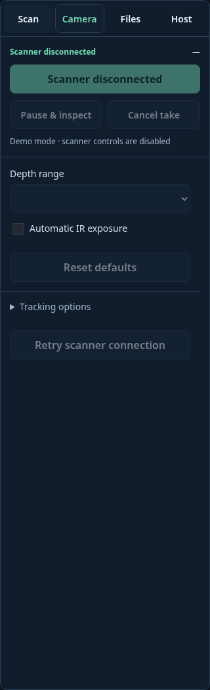
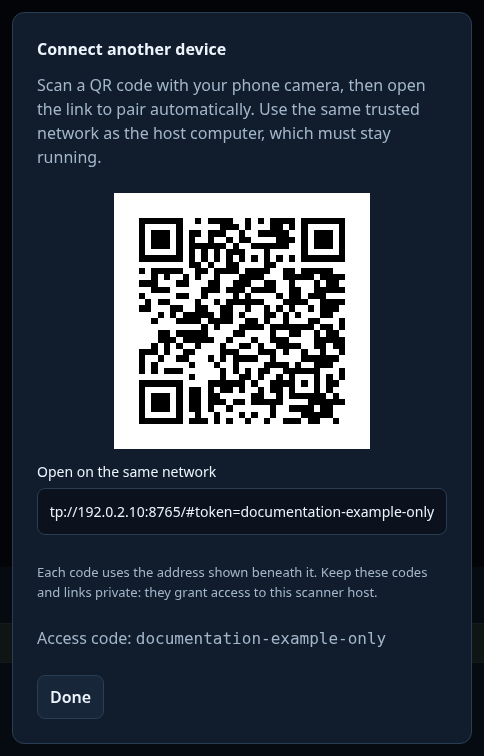
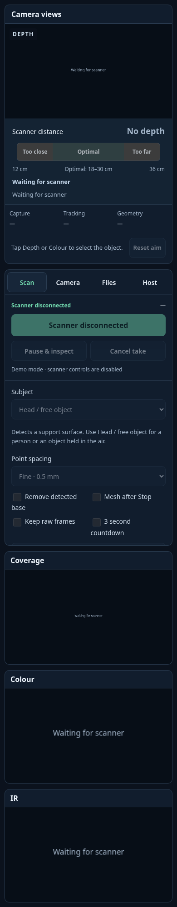
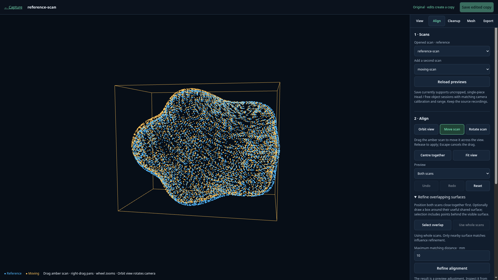
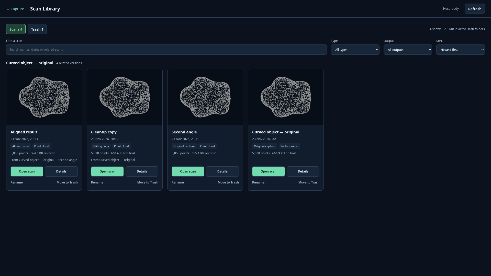

# Browser workspace tour

The scanner stays connected to the Linux host. A browser on the host, phone,
tablet or another computer controls the same capture session. Processing and
files stay on the host; the browser receives previews and sends commands.

These screenshots show the current interface in an isolated **demo session**,
with no scanner attached. Empty previews and disabled capture controls are
expected. They illustrate layout and navigation, not a completed scan or measured
performance. The QR example contains documentation-only credentials and address.

## Desktop capture workspace

The workspace uses the available screen up to 1920 pixels wide. On desktop,
the capture view fits the viewport height, with longer tool lists scrolling
inside the right panel. Smaller laptops use a more compact layout.

- **Left:** Coverage, Colour and IR previews. Their live image areas use 16:9 frames.
- **Centre:** Depth, with distance guidance directly beneath it, then capture,
  tracking and geometry status. Tap Depth or Colour to select the subject.
- **Right:** Four tool tabs, with the current phase, processing FPS/time when
  available, and capture actions beneath the tabs.

There is no top branding banner, footer banner, separate performance card or
second host-message panel. The scan views take priority.

## Tools grouped by task

| Tab | Controls | When to use it |
| --- | --- | --- |
| **Scan** | Subject, point spacing, base removal, meshing/raw/countdown options, continue latest scan, separate piece | Prepare a take and choose how it is saved |
| **Camera** | Depth range, IR exposure and device controls, tracking options, retry connection | Adjust the sensor or recover its connection |
| **Files** | Scan Library, return to live and raw capture tools | Find and open results, organise versions and manage recordings |
| **Host** | Connection state, phone pairing, guarded host restart, collapsed messages | Connect another browser or inspect host problems |

Start/stop, pause/resume, cancel and current status remain outside the tab panels,
so they stay visible whichever tool tab is selected. Switching tabs does not
pause, restart or otherwise alter a scan. Controls remain disabled whenever the
scanner or current capture state does not permit that action.

Use Left/Right arrows while a tab has keyboard focus to move between tabs. Home
selects Scan; End selects Host. Only the selected tab's panel is shown.

Camera tab screenshot

The empty range list and disabled hardware controls here reflect demo mode.
Connected hardware supplies the available controls and ranges.

## Pair a phone with a QR code

1. Put the phone and host on the same trusted network.
2. On the host browser, open **Host → Connect a phone**.
3. Scan the QR code with the phone camera and open its link. The link includes
   the access token, so the browser pairs automatically.
4. If several network addresses appear, use a code whose address the phone can
   reach. The pairing link and manual access code remain available as alternatives.

*Documentation example only: this code does not connect to a live scanner host.*

The QR image is generated locally by the bundled library. It does not send the
pairing link to an external QR service or require internet access to generate it.
Treat real QR codes like the pairing links: anyone with them can pair with that
host. Manual host starts generate new credentials; an in-app restart preserves
pairing for reconnecting browsers. Closing the dialog clears its displayed codes.

If no LAN address is found, the dialog explains this instead of displaying an
unusable code. Check the host network and listen address. See
[connection troubleshooting](troubleshooting.md#phone-cannot-connect-or-asks-for-pairing-again).

## Distance and paused coverage

The distance gauge belongs to **Depth**, including when Depth moves to the left
during inspection. The optimal band is guidance; a grey **Last** marker is an aged
reading, not current depth. See [distance and coverage](user-guide.md#read-distance-and-coverage)
for the coverage colours and limitations.

**Pause & inspect** moves the same coverage pane into the centre. Drag it to turn
the coverage camera, and use scroll/pinch or its buttons to zoom. This uses the
existing GPU coverage classifications rendered on the host. It does not open a
separate live point-cloud viewer. **Resume** returns coverage to the left and Depth
to the centre. Camera inspection does not change the scan's tracking pose.

## Phone layout

On narrow screens, the main camera view comes first, followed by the tabbed
controls and then the auxiliary previews. The page scrolls vertically; tool lists
can also scroll inside their panel. The same tabs, pairing session and capture
controls are used, with no phone app or scanner driver required.

390-pixel-wide phone screenshot

## Saved-scan alignment

**Files → Open Scan Library → Open scan → Align** opens the two-scan alignment tools inside the saved workspace.
It offers coloured overlays, corresponding-point fitting, numeric move/rotate
nudges and transform undo/redo. The opened scan loads as the blue reference;
choosing a second scan loads its amber preview automatically. **Move scan** and
**Rotate scan** let you drag the amber scan directly; **Orbit view** moves the
camera. Each completed drag is one undo step, and Escape cancels an active drag.
**Save aligned copy** creates a new full session;
the originals are preserved. The [saved-result workspace](saved-workspace.md) handles the result with View,
Align, Cleanup, Mesh and Export tabs. Edits create a copy automatically, and
lasso/crop processing has persistent undo/redo.
See the [alignment guide](alignment.md) for current restrictions and validation status.

After rough placement, **Refine alignment** proposes a local surface fit. Select
an optional overlap box to exclude unwanted geometry, review the sampled fit
report, and Undo to recover the manual placement if needed.

*Synthetic saved sessions; the blue reference stays fixed while the amber scan is adjusted.*

For installation and a complete capture walkthrough, use the [user guide](user-guide.md).

## Scan Library

**Files → Open Scan Library** opens the full-page thumbnail library. Search and
filter scans, rename display titles, inspect related versions/storage or move a
scan to reversible Bin. Open a card for all existing saved-workspace tools.
The library uses the same paired LAN session and adapts to phone width. See the
[library guide](scan-library.md), including why Bin retains files and storage.

## Desktop CAD handoff

Saved scans have a desktop-only ScanRuler section in **Export**. Download the STL
above it, open ScanRuler and load it there for modelling. If no saved STL exists,
the download exports the current surface in millimetres. It is a
manual file handoff; projects and STEP files are saved through ScanRuler. The saved workspace also has Frames for accepted-frame repair; the ScanRuler section is hidden on phones. See [CAD handoff](cad-handoff.md).

## Accepted frame repair

**Frames** opens the timeline and section-repair workspace. Inspect sampled
keyframe contributions, exclude/include ranges, or align a selected section
against retained frames with the existing mouse/landmark controls. Rebuilds and
Undo/Redo run through editing-copy history. See [frame editor](frame-editor.md).
